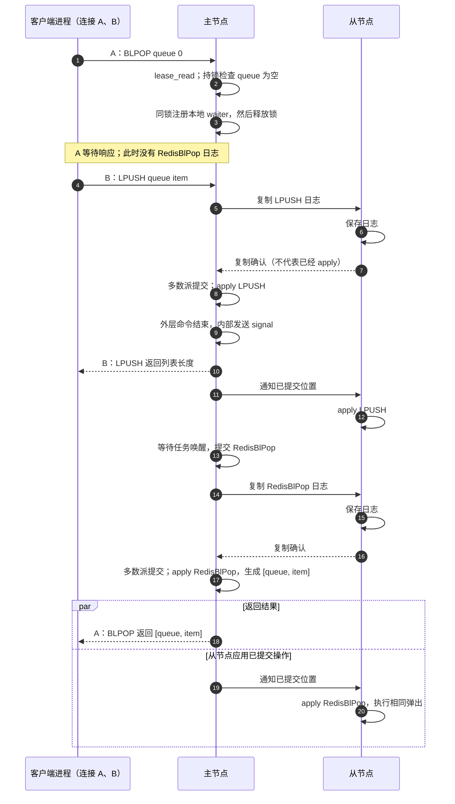
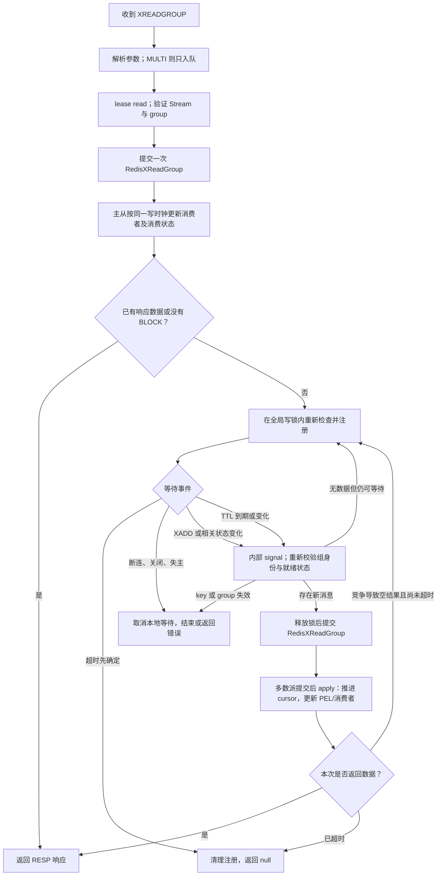

# 读取、阻塞与状态变更命令的共同执行模型

本文描述 XREAD、BLPOP、XREADGROUP 在 Cache-cat 中的执行边界。等待发生在主节点本地；修改 Redis 数据或元数据的行为必须通过 Raft。客户端只发送一次阻塞命令，主节点内部任务在收到 signal 后继续执行，客户端不会被要求再发送一次命令。

## 三类命令

| 命令 | 状态机变化 | 空结果时首次是否写 Raft | 就绪后的处理 |
| --- | --- | --- | --- |
| XREAD | 无，只读 Stream | 否 | 在受写锁保护的通知阶段生成完整读取结果 |
| BLPOP | 从一个 List 弹出元素 | 否 | 提交 RedisBlPop，由状态机重新选择 key 并弹出 |
| XREADGROUP | 更新消费者、group cursor、PEL 与投递元数据，不删除 Stream 消息 | 是，即使空读也会创建或更新消费者 | 提交 RedisXReadGroup，由状态机确定本次投递 |

这里的“读取”不等于只读命令。XREADGROUP 即使使用 NOACK，仍更新消费者及组游标；历史消息读取也可能更新投递时间和次数，因此均不能放入 ReadOperation，也不能在 lease read 或通知回调中直接修改这些状态。

## 确定性请求与快照

普通 Command 负责参数、事务入队、本地等待及连接生命周期。请求中只保留影响状态机的确定性输入；BLOCK、deadline、连接 ID、oneshot 接收端和本地等待资格不进入 Raft 日志或快照。网络读取首先经过 lease read，随后在全局 write_lock + read_lock 内检查状态；检查与注册必须在同一个写锁临界区完成。

BLPOP 使用 MultiReadComputeCommand，多 key 读取后只修改一个 key。快照保存已经计算好的 Insert/Del，恢复时不会重新选择源 key。

XREADGROUP 可以同时修改多个 Stream，所以使用一条 RedisXReadGroup 操作协调多个单 key XReadGroupStreamReq。先校验全部 key 的类型、消费组及身份，再依照参数顺序调用 ComputeCommand，外层持有 read_lock 的写 guard。每个操作只依赖自己的 key，保留 TTL；快照增量记录每个 key 的 XReadGroup 操作及 CAS 版本，恢复不重新进行跨 key 选择。重复 Stream key 按顺序读取更新后的状态，不会从同一个初始快照重复投递相同消息。正常执行不为每次读取克隆整条 Stream；构建快照期间复用已有 COW。

消费时间通过 RedisStream::xreadgroup_at 显式使用日志中的 write_clock。PEL 的投递时间、消费者 seen/active 时间都不读取节点本地物理时间。

消费组身份使用 `(Raft log index, 本条日志内的建组序号)`，仅在 XGROUP CREATE 时分配，并随组快照和创建增量保存。组删除、key 删除、同名组重建都不能复用旧身份。网络请求观察到的身份作为后续 Raft 请求的条件，由所有副本在实际执行前校验。这是状态机对象的身份，不是客户端 waiter ID；它用于关闭“本地检查通过后、日志执行前发生销毁重建”的窗口。

## 等待、通知与多个客户端

全局 write_lock 保护 WriteState；所有 BlockingKeys 都是普通可变状态，通过 Update.waiters 借用现有 guard，不增加各自的 Mutex 或原子计数。ApplyEffects 通过 Update.effects 收集本条外层操作影响的 key。嵌套 EXEC/Lua 只记录，整个外层命令结束后统一按最终状态通知，包含 Lua 已写入后返回错误的情况。CAS 恢复禁用本地通知。

XREAD 的通知可以生成只读响应。BLPOP 与 XREADGROUP 的通知只发送 signal，不执行弹出、修改 PEL，也不 await Raft 写入。接收 signal 的主节点任务释放缓存锁后提交确定性操作。收到空结果时重新检查并注册；没有固定间隔的数据轮询。

BLPOP 的队列按 key 就绪提示串行调度。XREADGROUP 的资格还依赖 group：同一 Stream 上，一个组可能已经读完，另一个组仍有新消息。signal_ready_many 先刷新本批受影响请求的资格，再选最早的合格 waiter；一个消费组读取正在提交时，不唤醒后来者去抢同组消息。请求执行后刷新其全部 Stream 的资格，撤销已读空组的旧资格，并让其他组或仍有数据的消费者继续执行。当前消费组 registry 使用一个全局 in-flight 名额，多个客户端可以同时等待，已唤醒的读取按名额串行提交。

消费组等待还需要响应 XGROUP 变更、删除、替换、清库与 TTL 设置等事件，以便返回错误或更新等待期限。自然过期使用本地一次性到期计时，TTL 变化通过 key 通知重新计算计时；它不在每条 Raft 日志后扫描所有等待者，也不以空读取日志推进轮询。

## XREADGROUP 协议行为

```text
XREADGROUP GROUP group consumer [COUNT count] [BLOCK milliseconds] [NOACK]
           STREAMS key [key ...] id [id ...]
```

GROUP、COUNT、BLOCK、NOACK 选项可以在 STREAMS 之前排列。COUNT 针对每条 Stream；不指定或使用非正值表示不限制条数，实际阻塞后也不擅自添加条数上限。BLOCK 使用整数毫秒，0 表示无限等待。

`>` 读取组中尚未投递的新消息；非 `>` 的合法 ID 读取该消费者 PEL 中严格大于该 ID 的历史记录。历史读取忽略 BLOCK 和 NOACK，即使没有历史消息也返回该 Stream 的空数组；混合历史 ID 和 `>` 的请求也不等待。历史记录对应的消息载荷已被删除时，返回 ID 与 null 载荷，不凭空恢复原消息。

正常新消息读取将消息写入 PEL，NOACK 跳过新增 PEL，但仍创建/更新消费者和推进游标。全部 key/group 的前置校验在任何消费状态变更之前完成。RESP2 返回 Stream/entries 的成对数组；RESP3 返回 map。MULTI 中仅排队，EXEC 中按非阻塞操作执行。Lua 中也执行确定性非阻塞读取，BLOCK 不使脚本挂起。

首次合法的空读取仍通过一条 Raft 日志创建或更新消费者，之后才进入本地等待。正常等待期间不持续追加空读取日志。已有数据且没有排队竞争时，使用一条 Raft 读取操作返回结果。

## BLPOP：先读空，再收到 LPUSH

以下为一个客户端进程使用两条连接：A 执行 BLPOP，B 执行 LPUSH。单条连接阻塞时，后续流水线命令只能缓冲，不能越过前面的阻塞命令执行。主节点与一个有投票权的从节点组成两节点示例，多数派为 2，因此写入需要两者确认；这不是可容忍一个节点故障的部署拓扑。



waiter signal 完全发生在主节点内部；从节点没有客户端 waiter 也执行相同 RedisBlPop。复制 ACK、日志提交、状态机 apply、客户端收到响应是不同事件，不能把复制 ACK 画成“从节点已经执行完命令”。

## XREADGROUP：空读、等待、投递



XADD 和后续消费组读取是两条独立的 Raft 操作。XREADGROUP 返回的是提交后的投递结果；它保留 Stream 消息，与 BLPOP 从列表删除元素不同。消费者确认、认领与业务处理成功是后续独立步骤，XREADGROUP 不隐含业务 ACK。

## 超时、断连和故障转移

等待超时与唤醒在同一个写锁下裁决。超时先移除注册，则不再为该次等待提交消费操作；deadline 前已被选中，则继续执行。提交后的 Raft 写不受本地等待 timeout 中止，避免先返回 null、之后消费状态却被更新。因此命令的 BLOCK 时间不是端到端响应时限。

断连、节点关闭或失主可以终止本地响应等待，但无法撤销已经提交的日志。客户端自己的 socket timeout 也不能撤销服务端写入；此时结果可能未知，不能把它当成确定未消费。XREADGROUP 在非 NOACK 模式下保留 PEL，供后续历史读取及确认/认领机制使用；业务仍应处理重复投递。Raft 的提交保证不等于客户端收到消息或业务恰好执行一次。

主节点的角色/任期变化通过 server_metrics 事件检测，不订阅每条日志的数据 metrics。旧 waiter 不迁移，返回 READONLY 或中断错误，由客户端重连。正常完成/超时在同一写锁下清理；意外 Drop 使用现有单一惰性清理任务，不为每个断连创建任务。

## 性能约束与扩展规则

- 普通 GET 的代码路径不变，不访问等待队列、通知集合或新计时器。
- 保留 apply 每批获取一次全局 write_lock 的方式；不新增每条普通命令的锁、原子计数或全库扫描。
- 通知收集使用 ApplyEffects 的普通集合，只在相关写入且有匹配等待者时插入；空集合不分配桶，小集合复用容量，大集合排空后释放。
- SET/DEL 等必须能使被观察的 Stream 失效，但只在存在消费组等待者时检查对应等待索引；无关 key 不创建通知记录。FLUSH 只枚举已注册等待 key。
- readiness 回调只读取受已有锁保护的数据。不能在回调内本地修改 PEL/List，也不能持锁 await app.write/client_write。
- 新命令先明确其真实访问模式：只读使用 ReadCommand/MultiReadCommand；单 key 元数据变化使用 ComputeCommand；多 key 选择单 key 写使用 MultiReadComputeCommand；多 key 独立写入先整体校验，再在一条 Raft 操作中按顺序执行单 key 写入。
- 任何会影响状态机的时间必须来自日志 write_clock；对象身份条件必须来自可复制的状态元数据，不能使用本地 Arc 地址、snapshot revision 或客户端数量决定副本行为。

实现验证包括：真实 TCP 与单节点 Raft、消费组公平调度、多 group 独立投递、PEL/NOACK/历史记录、TTL/删除重建、事务与 Lua、RESP2/RESP3、快照 CAS 恢复、空等待日志数量及失主清理。
